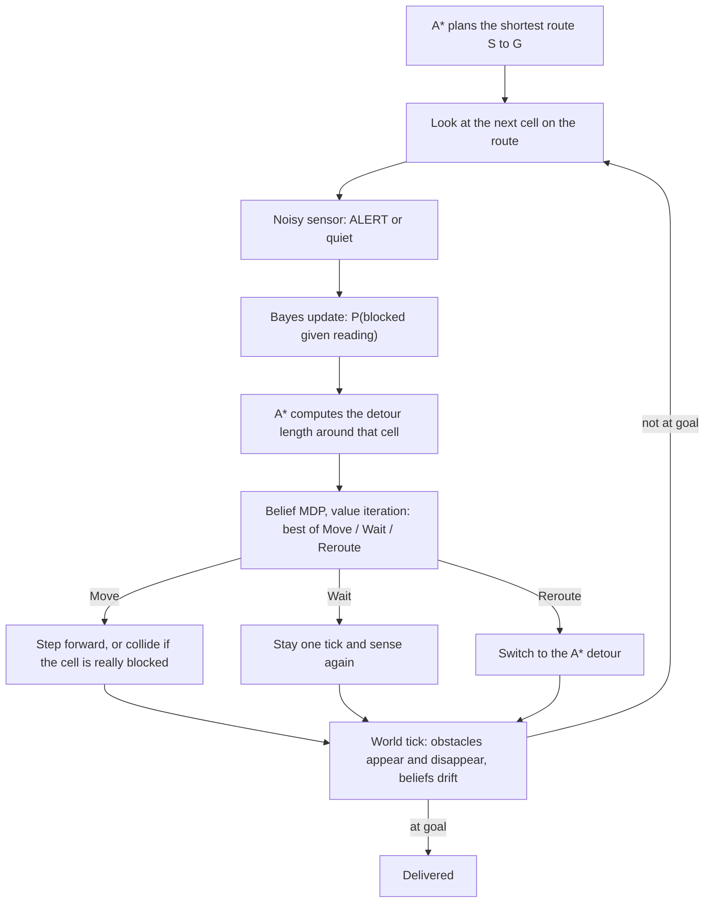

# Campus Delivery Robot

**AI Fundamentals — Final Project** · Author: Karim · November 2026

A small delivery robot has to carry a package from the main gate of a campus to a
dormitory. The map is known, but busy areas (cafeteria, library, sports hall) are often
temporarily blocked by people or carts, and the robot's obstacle sensor is noisy: it
misses real obstacles and raises false alarms. The robot must reach the goal **fast
and without collisions**, so it has to plan a route, reason about uncertain sensor
readings, and decide when to go, wait or take a detour.

The project combines **three algorithms from three different course topics** into one
decision loop and measures how much each one contributes.

| Course topic | Algorithm | File | What it does in the robot |
|---|---|---|---|
| Search | **A\*** with Manhattan heuristic (+ BFS, UCS, Greedy for comparison) | [`robot/search.py`](robot/search.py) | Plans the shortest route on the campus grid and computes the length of a detour around a suspicious cell |
| Probabilistic reasoning | **Bayes filter** (measurement update with Bayes' rule + Markov time update) | [`robot/bayes.py`](robot/bayes.py) | Turns noisy sensor beeps into a probability that the next cell is blocked |
| Markov decision processes | **Belief MDP solved by value iteration** (Bellman optimality update) | [`robot/mdp.py`](robot/mdp.py) | Chooses **Move / Wait / Reroute** by trading off delivery time against collision risk |

The three parts are wired together in [`robot/simulation.py`](robot/simulation.py).

## How the decision loop works



## Quick start

```bash
python3 -m venv .venv && source .venv/bin/activate
pip install -r requirements.txt

python main.py                          # CLI walkthrough (standard library only)
python main.py --map "Classic 5x5"      # the original 5x5 map from version 1
python main.py --policy naive           # same world, robot that ignores the sensor
python main.py --compare 500            # compare all policies over 500 deliveries

streamlit run app.py                    # interactive web UI
pytest                                  # run the test suite
python experiments/run_experiments.py   # reproduce every number in the report
```

The algorithms and the CLI need only the Python standard library (Python 3.10+).
`streamlit` is needed for the web UI and `pytest` for the tests.

## Example output

```text
[1] SEARCH -- A* route planning
  Algorithm        Path length  Nodes expanded
  A*                        19              22
  UCS (Dijkstra)            19              69
  BFS                       19              69
  Greedy                    19              22

[2] PROBABILISTIC REASONING -- Bayes filter
P(alert) = 0.9*0.3 + 0.2*0.7      = 0.41
Posterior P(blocked | alert)      = 0.27 / 0.41 = 0.659
Posterior P(blocked | no alert)   = 0.051
Same alert on an ordinary cell    = 0.084   (rare obstacles -> alert is probably false)

[3] DECISION MAKING -- MDP solved by value iteration
  [no detour] value iteration converged in 50 sweeps
     at P(blocked)=0.659: Q(Move)=-37.81, Q(Wait)=-6.49
     -> best action: WAIT   (Move is optimal only while P(blocked) < 0.064)

[4] MISSION -- policy 'bayes_mdp' (Bayes + MDP (full system)), seed 5
  t=  7 at (2, 5) next (2, 6): sensor ALERT P(blocked) 0.30->0.66  => Reroute [rerouted, truth: blocked]
  t= 11 at (4, 4) next (5, 4): sensor ALERT P(blocked) 0.30->0.66  => Wait    [waited, truth: blocked]
  t= 12 at (4, 4) next (5, 4): sensor quiet P(blocked) 0.48->0.10  => Wait    [waited, truth: clear]

  Delivered: True  ticks: 24  collisions: 0  waits: 2  reroutes: 1  total cost: 24
```

On the same world (seed 5) the robot that ignores its sensor (`--policy naive`)
collides 3 times and has a total cost of 172.

## Results

1000 simulated deliveries per policy on the campus map; every policy sees the same
worlds. Cost = delivery ticks + 50 × collisions (lower is better).

| Policy | Avg cost | Avg ticks | Collisions / delivery | Collision-free deliveries |
|---|---|---|---|---|
| A* only (ignore sensor) | 129.82 | 21.17 | 2.173 | 37.9% |
| Raw sensor (wait on alert) | 38.29 | 26.39 | 0.238 | 80.8% |
| Bayes + 0.5 threshold | 48.23 | 22.03 | 0.524 | 63.4% |
| **Bayes + MDP (full system)** | **35.75** | 28.80 | **0.139** | **87.6%** |

The full system has the lowest cost and the fewest collisions. When the collision
penalty is varied (5, 20, 50, 100), it is the best policy at 5, 50 and 100 and within
0.2 of the best at 20, while each fixed rule is good only in a narrow range.
All tables are in [`results/RESULTS.md`](results/RESULTS.md).

## Project structure

```text
delivery-robot/
├── robot/                  # the AI core (standard library only)
│   ├── grid.py             # campus maps (ASCII), obstacle risk, random map generator
│   ├── search.py           # Topic 1: A*, UCS, BFS, Greedy
│   ├── bayes.py            # Topic 2: sensor model, Bayes update, time update
│   ├── mdp.py              # Topic 3: generic MDP, value iteration, belief MDP
│   └── simulation.py       # hidden world, decision loop, 4 policies, evaluation
├── main.py                 # command-line demo
├── app.py                  # Streamlit web UI
├── tests/                  # pytest suite
├── experiments/
│   └── run_experiments.py  # experiments E1–E6
├── results/                # RESULTS.md and results.json (generated)
├── docs/                   # report, declarations, demo-video script
├── requirements.txt
└── pyproject.toml
```

## Testing

`pytest` runs **216 tests** for the algorithms and the simulation
(`test_search.py`, `test_bayes.py`, `test_mdp.py`, `test_simulation.py`), plus a UI
smoke test (`tests/test_app.py`) that runs the Streamlit app headlessly with
`streamlit.testing`. Highlights:

- **A\***: optimality checked against BFS on 150 random maps; the heuristic is checked
  to be admissible for every cell; unreachable goals, blocked cells, start = goal;
  a map where Greedy returns 18 steps and A\* returns 16.
- **Bayes**: the hand calculation 0.27 / 0.41 = 0.659, two alerts → 0.897, invalid
  inputs rejected, and a Monte-Carlo test (200 000 samples) confirming that the
  formula matches the observed frequency.
- **MDP**: value iteration on textbook MDPs with known values, every transition row
  sums to 1, convergence, sensible decisions (surely clear → Move, after an alert → Wait,
  cheap detour → Reroute), higher penalty → more careful robot.
- **Integration**: every policy delivers on 30 seeds, runs are reproducible, the log is
  consistent, the full system is safer than the naive robot, and it never crashes on
  25 random maps.

## Limitations

- Each encounter is decided on its own: the MDP does not price obstacle risk on the
  detour or on the rest of the route.
- The sensor model (90% detection, 20% false alarms) and obstacle dynamics are assumed
  to be known exactly; they are not learned from data.
- The world is a small grid with unit step costs and one robot.

See the [technical report](docs/TECHNICAL_REPORT.md) for the analysis and future work.

## Documents

- [Technical report](docs/TECHNICAL_REPORT.md)
- [AI usage declaration](docs/AI_USAGE_DECLARATION.md)
- [Contribution statement](docs/CONTRIBUTION_STATEMENT.md)
- [Demo video script](docs/DEMO_VIDEO_SCRIPT.md)
- [Presentation slides (PDF, Russian)](docs/PRESENTATION_RU.pdf)
- [Experiment results](results/RESULTS.md)
